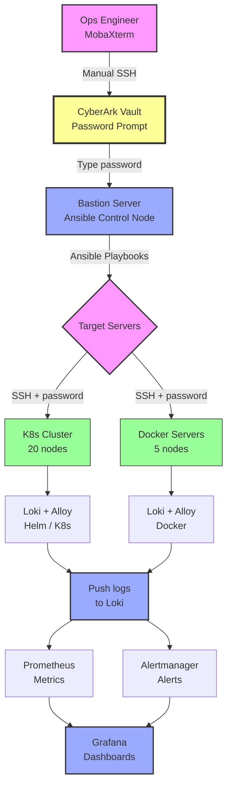

# Monitoring Stack Architecture — Production
# Copy this Mermaid code into https://mermaid.live

## Legend

| Color | Meaning |
|-------|---------|
| Yellow | CyberArk — interactive password required |
| Blue | Working / desired state |
| Pink | User / operator |
| Green | Target servers |
| Blue (bottom) | Monitoring stack |

## Key Message for Head of Cybersecurity

> **Current state:** Ansible is blocked because every target server prompts for an interactive CyberArk password. Manual login via MobaXterm works, but deploying 30+ servers manually is not sustainable.
>
> **Requested:** Non-interactive access from the bastion — SSH key deployed via CyberArk, a service account, or a proxy configuration. The architecture, playbooks, and everything else is ready.